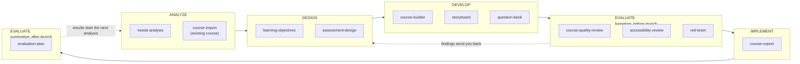
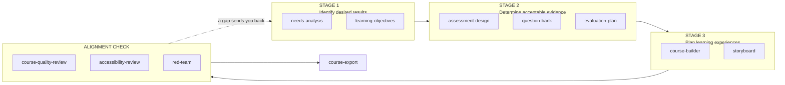
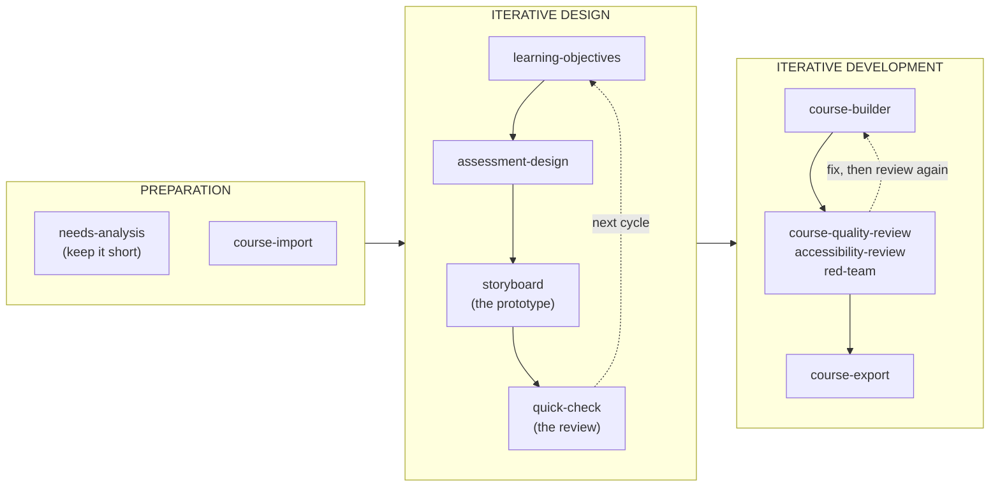

# idstack and the instructional design frameworks

You know ADDIE, backward design or SAM. This page shows where each idstack skill is in the framework that you use. It is the one map of skills to phases: the README, the infographic and the skill descriptions follow it.

idstack does not replace your framework. Each skill does the work of one phase, with the research behind each recommendation.

**Contents:** [One-page map](#one-page-map) · [ADDIE](#addie) · [Backward design](#backward-design) · [SAM](#sam) · [Which framework do I use?](#which-framework-do-i-use) · [Frameworks inside the skills](#frameworks-inside-the-skills) · [What idstack does not do](#what-idstack-does-not-do)

## One-page map

Type `/idstack:` before each skill name, or tell Claude what you want in your own words ("I am in the Design phase", "do Stage 2 for this unit").

| Skill | What you get | ADDIE | Backward design | SAM |
|-------|--------------|-------|-----------------|-----|
| `needs-analysis` | Is training the answer? Tasks and learner profile | Analyze | Stage 1: desired results | Preparation |
| `course-import` | Your existing course, read and mapped | Analyze | Stage 1: desired results | Preparation |
| `learning-objectives` | Measurable objectives, Bloom's levels, alignment matrix | Design | Stage 1: desired results | Iterative design |
| `assessment-design` | Assessments, rubrics, feedback plan | Design | Stage 2: acceptable evidence | Iterative design |
| `question-bank` | Test blueprint, questions, answer key | Develop | Stage 2: acceptable evidence | Iterative development |
| `storyboard` | Screens, narration, visuals, learner actions | Develop | Stage 3: learning plan | Iterative design (the prototype) |
| `course-builder` | Syllabus, module pages, assignments, rubrics | Develop | Stage 3: learning plan | Iterative development |
| `course-quality-review` | Quality Matters and Community of Inquiry audit | Evaluate (formative) | Alignment check | Iterative development (review) |
| `accessibility-review` | WCAG 2.1 AA and UDL review | Evaluate (formative) | Alignment check | Iterative development (review) |
| `red-team` | Stress test and confidence score | Evaluate (formative) | Alignment check | Iterative development (review) |
| `course-export` | Common Cartridge, SCORM or Canvas push | Implement | After the three stages | Iterative development (release) |
| `evaluation-plan` | Measures of reaction, learning, behavior and results | Evaluate (summative) | Stage 2: acceptable evidence | Preparation, then after release |
| `quick-check` | Feedback on one item in one minute | Evaluate (formative), in each phase | In each stage | Each review |
| `pipeline` | Runs the eight main skills in sequence | Analyze to Implement | All stages | One full cycle |
| `start` | Checks the setup and starts the correct skill | Before Analyze | Before Stage 1 | Before Preparation |
| `learn` | What idstack learned on your earlier courses | Each phase | Each stage | Each cycle |

## ADDIE

ADDIE has five phases: Analyze, Design, Develop, Implement, Evaluate. Evaluation is not only the last phase. You evaluate the design before learners see it (formative), and you evaluate the results after they complete it (summative). idstack does the same: three review skills run before the export, and the evaluation plan measures the results after the course runs.

| Phase | The question of the phase | Run | Leave the phase when |
|-------|--------------------------|-----|----------------------|
| Analyze | Is training the answer, for which tasks, for which learners? | `/idstack:needs-analysis`. For a course that exists: `/idstack:course-import` | You have a training decision, a task list and a learner profile |
| Design | What will learners be able to do, and how will you know? | `/idstack:learning-objectives`, then `/idstack:assessment-design` | Each objective has an assessment and a planned activity |
| Develop | What do learners see and do? | `/idstack:course-builder`. For media and tests: `/idstack:storyboard`, `/idstack:question-bank` | The syllabus, modules, assignments and rubrics are written |
| Evaluate (formative) | Is the course ready for learners? | `/idstack:course-quality-review`, `/idstack:accessibility-review`, `/idstack:red-team` | Quality is 70 or more, accessibility is 80 or more, and no critical finding remains |
| Implement | How does the course get to learners? | `/idstack:course-export` | The course is in your LMS |
| Evaluate (summative) | Did the course work? | `/idstack:evaluation-plan` | You have the data for the decisions that the results must support |

`/idstack:pipeline` runs Analyze to Implement in this sequence and continues where you stopped.

Two notes from practice:

- **Write the evaluation plan in the Design phase, not after the launch.** The measures of behavior and results need a baseline, and you can get a baseline only before the course runs. Needs assessment and evaluation are two ends of one thread [Needs-6] [T3].
- **ADDIE is a loop.** A finding in a review sends you back to Design or Develop. `/idstack:red-team` has a fix loop for this, and each skill can run again at any time.

## Backward design

Backward design (Wiggins and McTighe, *Understanding by Design*) has three stages. You start from the results, then you decide the evidence, and only then do you plan the lessons. The idstack pipeline uses this sequence: objectives, then assessments, then content. If you use `/idstack:pipeline`, you already use backward design.

| Stage | The question of the stage | Run | Leave the stage when |
|-------|--------------------------|-----|----------------------|
| 1. Desired results | What will learners know and be able to do? | `/idstack:learning-objectives`. For the context first: `/idstack:needs-analysis` | Each objective is measurable and has a Bloom's level |
| 2. Acceptable evidence | What will show that they can do it? | `/idstack:assessment-design`. For test items: `/idstack:question-bank` | Each objective has evidence at the same cognitive level |
| 3. Learning experiences and instruction | What practice and content get them there? | `/idstack:course-builder`. For media: `/idstack:storyboard` | Each activity prepares learners for an assessment |
| Alignment check | Does the chain hold? | `/idstack:course-quality-review`, `/idstack:accessibility-review`, `/idstack:red-team` | No objective is without evidence, and no activity is without an objective |

The most common error in backward design is to go to Stage 3 too early. You write the lessons, and then you look for something to grade. idstack makes this hard to do. `/idstack:course-builder` reads the objectives and the assessments from the manifest, and `/idstack:learning-objectives` flags each objective that has no assessment or no activity. The research name for this chain is constructive alignment [Alignment-1] [T5].

**A teacher with one unit, not a full course?** Run `/idstack:learning-objectives` for the unit, then `/idstack:assessment-design`, then `/idstack:course-builder`. You do not need the needs analysis.

## SAM

SAM (the Successive Approximation Model, Allen) replaces the long sequence with short cycles: a small design, a prototype, a review, and then the next cycle. Use it when time is short and the requirements are not clear until people see something.

| Phase | Run | How to keep the cycle short |
|-------|-----|------------------------------|
| Preparation | `/idstack:needs-analysis`, or `/idstack:course-import` for a course that exists | Answer from what you know. Do not wait for more data |
| Iterative design | `/idstack:learning-objectives`, `/idstack:assessment-design`, `/idstack:storyboard`, `/idstack:quick-check` | Storyboard one module as the prototype. Show it to the subject matter expert. Paste each changed item into `/idstack:quick-check` |
| Iterative development | `/idstack:course-builder`, the three review skills, `/idstack:course-export` | Build one module, review it, correct it, then build the next. The `/idstack:red-team` fix loop is one cycle |

Each idstack skill can run again, and the manifest keeps your decisions between runs. That makes the cycles cheap. One comparison with a linear model found better skill progress with rapid prototyping in design projects [Prototype-16] [T2]. ADDIE and rapid prototyping also work together [Prototype-4] [T4].

## Which framework do I use?

No framework is the best one for every project. Reviews of the models find that each one fits a different context [ID-7] [T3].

| Your situation | Use | Start with |
|----------------|-----|------------|
| A large project with stakeholders who approve each phase, or compliance training | ADDIE | `/idstack:pipeline` |
| You do not know if training is the answer | ADDIE | `/idstack:needs-analysis` |
| A faculty member or teacher who designs a course or a unit | Backward design | `/idstack:learning-objectives` |
| A course that exists and has grades that do not agree with its objectives | Backward design | `/idstack:course-import`, then `/idstack:course-quality-review` |
| A short timeline, with a subject matter expert who can review often | SAM | `/idstack:storyboard` and `/idstack:quick-check` |
| The requirements change each time people see a draft | SAM | A short `/idstack:needs-analysis`, then `/idstack:storyboard` |
| Not sure | Any | `/idstack:start` |

You can mix them. Many experienced designers use ADDIE for the project phases and backward design for the sequence in the Design and Develop phases. They use short SAM cycles in the Develop phase. The idstack pipeline is that mix.

**Dick and Carey, ASSURE, Kemp, 4C/ID or a different model?** The phases have different names, but the work is the same: analyze, set objectives, plan the evidence, build, review, deliver, evaluate. Find your step in the "What you get" column of the [one-page map](#one-page-map).

## Frameworks inside the skills

These frameworks are not project models. Each one is the method of one skill.

| Framework | Where idstack uses it |
|-----------|----------------------|
| Revised Bloom's taxonomy | `/idstack:learning-objectives`, `/idstack:assessment-design`, `/idstack:question-bank` |
| Constructive alignment | `/idstack:learning-objectives`, `/idstack:course-quality-review`, `/idstack:red-team` |
| Three-level needs assessment (organization, task, learner) | `/idstack:needs-analysis` |
| Nicol's seven principles of feedback | `/idstack:assessment-design` |
| Cognitive load theory | `/idstack:course-builder`, `/idstack:red-team` |
| Mayer's multimedia principles | `/idstack:storyboard` |
| Quality Matters and Community of Inquiry | `/idstack:course-quality-review` |
| WCAG 2.1 AA and UDL 3.0 | `/idstack:accessibility-review` |
| Kirkpatrick's four levels | `/idstack:evaluation-plan` |

## What idstack does not do

- **Delivery.** The Implement phase of ADDIE includes the training of facilitators, the pilot run and learner support. idstack makes the package and puts it in the LMS. The delivery is your work.
- **Data collection.** `/idstack:evaluation-plan` writes the plan, the survey items and the schedule. It does not collect or analyze the data.
- **The selection of your framework.** The table above is a guide. You know your organization.

The citations on this page (`[Code-N] [Tn]`) are in [evidence/references.md](../evidence/references.md).
